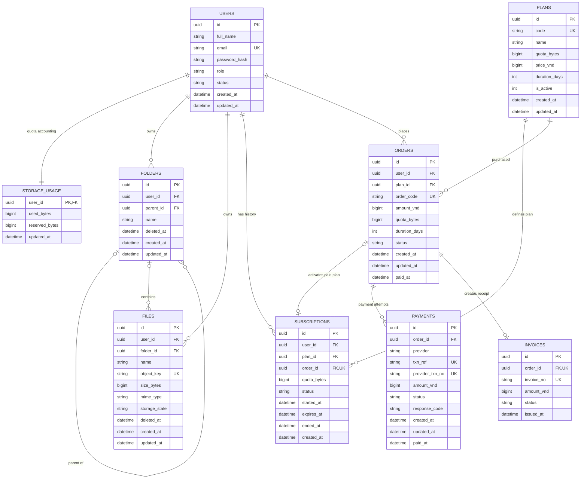

# CloudDS – Thiết kế ERD MySQL (Giai đoạn 2)

**Trạng thái:** Bản thiết kế đề xuất, **chưa tạo bảng và chưa triển khai SQLAlchemy**.  
**Căn cứ:** `docs/01-requirements.md`, `docs/04-api-contract.md`, các trang frontend trong bản dự án RAR mới nhất.  
**Phạm vi:** Đăng ký/đăng nhập, quản lý tệp-thư mục, quota, thùng rác, Free/Basic/VIP, đơn hàng, VNPay Sandbox, biên nhận, admin cơ bản.

> **Quan trọng về phiên bản tài liệu:** Phần đầu của `01-requirements.md` vẫn dùng ví dụ Free/Basic/Pro và giá/dung lượng minh họa; **phần CHỐT ở cuối file** quy định **Free 500 MB miễn phí, Basic 2 GB giá 10.000đ/tháng, VIP 5 GB giá 20.000đ/tháng**, giới hạn **100 MB/tệp**. ERD dùng bảng `plans` cấu hình động, không khóa cứng tên hay giá trong cấu trúc.

## 1. Sơ đồ quan hệ

Xem sơ đồ tổng quan và hai sơ đồ phóng to trong thư mục `docs/diagrams/`.

**Ký hiệu:** PK = khóa chính; FK = khóa ngoại; UK/UQ = giá trị duy nhất; `o|` = quan hệ có thể không tồn tại; `{` = nhiều bản ghi.

## 2. Danh sách 9 bảng

| Bảng | Vai trò |
|---|---|
| `users` | Tài khoản, mật khẩu băm, vai trò user/admin, trạng thái |
| `storage_usage` | Tổng byte đang sử dụng và byte đã giữ chỗ khi upload; một dòng cho mỗi user |
| `folders` | Cây thư mục logic, có thư mục cha hoặc root |
| `files` | Metadata tệp và khóa object Garage, không chứa nội dung file |
| `plans` | Danh mục gói Free/Basic/VIP, giá VND, quota, thời hạn và trạng thái bán |
| `subscriptions` | Lịch sử gói mỗi user, gói đang hiệu lực, quota snapshot và hạn dùng |
| `orders` | Đơn đặt mua gói, lưu snapshot giá/quota/thời hạn tại lúc mua |
| `payments` | Các lần thử thanh toán VNPay của đơn, mã giao dịch và kết quả xác minh |
| `invoices` | Biên nhận nội bộ cho đơn thanh toán thành công; không phải hóa đơn VAT |

## 3. Các cột của từng bảng

Các `id` UUID là `CHAR(36)` trong MySQL để dễ triển khai với Flask (API luôn trả chuỗi UUID). `DATETIME(6)` được ứng dụng lưu dưới dạng **UTC**, API định dạng ISO 8601 có `Z`.

### `users`

| Cột | Kiểu MySQL đề xuất | Ghi chú |
|---|---|---|
| `id` | `CHAR(36)` | PK, NOT NULL |
| `full_name` | `VARCHAR(100)` | NOT NULL |
| `email` | `VARCHAR(254)` | UNIQUE, NOT NULL |
| `password_hash` | `VARCHAR(255)` | NOT NULL |
| `role` | `VARCHAR(16)` | NOT NULL |
| `status` | `VARCHAR(16)` | NOT NULL |
| `created_at` | `DATETIME(6)` | NOT NULL |
| `updated_at` | `DATETIME(6)` | NOT NULL |

### `storage_usage`

| Cột | Kiểu MySQL đề xuất | Ghi chú |
|---|---|---|
| `user_id` | `CHAR(36)` | PK FK, NOT NULL |
| `used_bytes` | `BIGINT UNSIGNED` | NOT NULL |
| `reserved_bytes` | `BIGINT UNSIGNED` | NOT NULL |
| `updated_at` | `DATETIME(6)` | NOT NULL |

### `folders`

| Cột | Kiểu MySQL đề xuất | Ghi chú |
|---|---|---|
| `id` | `CHAR(36)` | PK, NOT NULL |
| `user_id` | `CHAR(36)` | FK, NOT NULL |
| `parent_id` | `CHAR(36)` | FK NULL |
| `name` | `VARCHAR(255)` | NOT NULL |
| `deleted_at` | `DATETIME(6)` | NULL |
| `created_at` | `DATETIME(6)` | NOT NULL |
| `updated_at` | `DATETIME(6)` | NOT NULL |

### `files`

| Cột | Kiểu MySQL đề xuất | Ghi chú |
|---|---|---|
| `id` | `CHAR(36)` | PK, NOT NULL |
| `user_id` | `CHAR(36)` | FK, NOT NULL |
| `folder_id` | `CHAR(36)` | FK NULL |
| `name` | `VARCHAR(255)` | NOT NULL |
| `object_key` | `VARCHAR(512)` | UNIQUE, NOT NULL |
| `size_bytes` | `BIGINT UNSIGNED` | NOT NULL |
| `mime_type` | `VARCHAR(255)` | NOT NULL |
| `storage_state` | `VARCHAR(16)` | NOT NULL |
| `deleted_at` | `DATETIME(6)` | NULL |
| `created_at` | `DATETIME(6)` | NOT NULL |
| `updated_at` | `DATETIME(6)` | NOT NULL |

### `plans`

| Cột | Kiểu MySQL đề xuất | Ghi chú |
|---|---|---|
| `id` | `CHAR(36)` | PK, NOT NULL |
| `code` | `VARCHAR(32)` | UNIQUE, NOT NULL |
| `name` | `VARCHAR(80)` | NOT NULL |
| `quota_bytes` | `BIGINT UNSIGNED` | NOT NULL |
| `price_vnd` | `BIGINT UNSIGNED` | NOT NULL |
| `duration_days` | `INT UNSIGNED` | NULL |
| `is_active` | `BOOLEAN` | NOT NULL |
| `created_at` | `DATETIME(6)` | NOT NULL |
| `updated_at` | `DATETIME(6)` | NOT NULL |

### `subscriptions`

| Cột | Kiểu MySQL đề xuất | Ghi chú |
|---|---|---|
| `id` | `CHAR(36)` | PK, NOT NULL |
| `user_id` | `CHAR(36)` | FK, NOT NULL |
| `plan_id` | `CHAR(36)` | FK, NOT NULL |
| `order_id` | `CHAR(36)` | FK UNIQUE NULL |
| `quota_bytes` | `BIGINT UNSIGNED` | NOT NULL |
| `status` | `VARCHAR(16)` | NOT NULL |
| `started_at` | `DATETIME(6)` | NOT NULL |
| `expires_at` | `DATETIME(6)` | NULL |
| `ended_at` | `DATETIME(6)` | NULL |
| `created_at` | `DATETIME(6)` | NOT NULL |

### `orders`

| Cột | Kiểu MySQL đề xuất | Ghi chú |
|---|---|---|
| `id` | `CHAR(36)` | PK, NOT NULL |
| `user_id` | `CHAR(36)` | FK, NOT NULL |
| `plan_id` | `CHAR(36)` | FK, NOT NULL |
| `order_code` | `VARCHAR(40)` | UNIQUE, NOT NULL |
| `amount_vnd` | `BIGINT UNSIGNED` | NOT NULL |
| `quota_bytes` | `BIGINT UNSIGNED` | NOT NULL |
| `duration_days` | `INT UNSIGNED` | NOT NULL |
| `status` | `VARCHAR(16)` | NOT NULL |
| `created_at` | `DATETIME(6)` | NOT NULL |
| `updated_at` | `DATETIME(6)` | NOT NULL |
| `paid_at` | `DATETIME(6)` | NULL |

### `payments`

| Cột | Kiểu MySQL đề xuất | Ghi chú |
|---|---|---|
| `id` | `CHAR(36)` | PK, NOT NULL |
| `order_id` | `CHAR(36)` | FK, NOT NULL |
| `provider` | `VARCHAR(16)` | NOT NULL |
| `txn_ref` | `VARCHAR(64)` | UNIQUE, NOT NULL |
| `provider_txn_no` | `VARCHAR(64)` | UNIQUE NULL |
| `amount_vnd` | `BIGINT UNSIGNED` | NOT NULL |
| `status` | `VARCHAR(16)` | NOT NULL |
| `response_code` | `VARCHAR(16)` | NULL |
| `created_at` | `DATETIME(6)` | NOT NULL |
| `updated_at` | `DATETIME(6)` | NOT NULL |
| `paid_at` | `DATETIME(6)` | NULL |

### `invoices`

| Cột | Kiểu MySQL đề xuất | Ghi chú |
|---|---|---|
| `id` | `CHAR(36)` | PK, NOT NULL |
| `order_id` | `CHAR(36)` | FK UNIQUE, NOT NULL |
| `invoice_no` | `VARCHAR(40)` | UNIQUE, NOT NULL |
| `amount_vnd` | `BIGINT UNSIGNED` | NOT NULL |
| `status` | `VARCHAR(16)` | NOT NULL |
| `issued_at` | `DATETIME(6)` | NOT NULL |

## 4. Quan hệ và các ràng buộc quan trọng

1. **Cô lập dữ liệu theo người dùng:** `files.user_id` và `folders.user_id` tham chiếu `users.id`. `files.(user_id,folder_id)` tham chiếu `folders.(user_id,id)`; `folders.(user_id,parent_id)` tham chiếu `folders.(user_id,id)` để **không thể gắn file/thư mục vào thư mục của tài khoản khác**. Root được lưu `NULL` (API hiển thị chuỗi `"root"`). Tạo thêm khóa duy nhất `(user_id,id)` ở `folders` để hỗ trợ composite FK.
2. **Cây thư mục:** `folders.parent_id` tự tham chiếu `folders.id` (trong triển khai MySQL dùng composite FK kể trên). Backend cần kiểm tra chu trình: không được chuyển một thư mục vào chính nó hoặc hậu duệ.
3. **Garage:** `files.object_key` là duy nhất, ngẫu nhiên và **không** phải tên file. Không lưu bytes tệp trong MySQL, không tạo bảng `garage`. Bucket/key và quyền truy cập ở backend.
4. **Thùng rác:** `deleted_at=NULL` là đang hoạt động. Xóa thư mục đặt `deleted_at` ở **thư mục gốc được xóa**; toàn bộ hậu duệ bị ẩn/xem là trong trash **theo cây tổ tiên** (không cần sửa hàng nghìn dòng con). Những phần tử đã xóa trước đó vẫn giữ `deleted_at` riêng. Khôi phục trả về vị trí cũ nếu còn tồn tại, không thì root theo hợp đồng API. Xóa vĩnh viễn một thư mục xử lý đệ quy tất cả object trước khi xóa metadata. **Xóa mềm không giảm quota**.
5. **Tên trùng:** Với cùng một thư mục, không cho trùng tên **trong cùng loại** tệp hoặc thư mục đang hoạt động. MySQL `UNIQUE(user_id,folder_id,name,deleted_at)` **không đủ** vì `NULL` có thể lặp; khi viết migration phải dùng generated columns + unique index cho `COALESCE(parent_id, 'root')` và tên chỉ khi chưa xóa, hoặc giải pháp tương đương có kiểm soát đồng thời.
6. **Quota và upload đồng thời:** `storage_usage.used_bytes` tính bytes của tệp đã tải lên thành công, **kể cả trong Trash**; `reserved_bytes` giữ chỗ lúc đang upload. Backend khóa hàng quota trong transaction (ví dụ `SELECT ... FOR UPDATE`) để tránh hai upload đồng thời vượt hạn mức. Khi thất bại phải hủy reservation, dọn object lỗi; đối soát tổng từ `files` định kỳ.
7. **Gói hiện tại:** `users 1-N subscriptions`; gói Free được cấp lúc đăng ký, `expires_at=NULL`; gói trả phí có hạn. **Tối đa 1 subscription `active`/user** — cần bảo đảm bằng transaction và generated unique index cho trạng thái active (MySQL không có partial UNIQUE trực tiếp). `subscriptions.quota_bytes` chụp quota khi kích hoạt để gói đã mua không bị admin sửa ngược.
8. **Đơn hàng:** `orders` chụp `amount_vnd`, `quota_bytes`, `duration_days` từ plan lúc mua; không nhận giá từ frontend. Tạo composite FK `subscriptions.(user_id,order_id)` → `orders.(user_id,id)` để gói trả phí không được gắn nhầm đơn của tài khoản khác. Một order có thể có nhiều `payments` (retry), nhưng chỉ **một kết quả trả tiền hợp lệ** được kích hoạt quyền lợi.
9. **VNPay:** `payments.txn_ref` phải `UNIQUE` và khác nhau giữa các lần thử. Có thể có `provider_txn_no` nếu VNPay trả về. Callback IPN phải xác minh chữ ký, số tiền, trạng thái rồi **cập nhật order + payment + subscription trong transaction, có khóa dòng**, chống xử lý trùng. Return URL chỉ hiển thị.
10. **Biên nhận:** `invoices.order_id` `UNIQUE` → một đơn tối đa một biên nhận; chỉ tạo khi xác nhận thanh toán thành công.
11. **Khóa ngoại và xóa dữ liệu:** ưu tiên `RESTRICT/NO ACTION` cho users/orders/payments, không `ON DELETE CASCADE` bừa bãi khiến mất lịch sử; dùng `status`/`deleted_at` cho thao tác nghiệp vụ và quy trình dọn Garage riêng.
12. **Index cần có:** `users.email UNIQUE`; `plans.code UNIQUE`; `folders(user_id,parent_id,deleted_at)`; `files(user_id,folder_id,deleted_at)`; `subscriptions(user_id,status,expires_at)`; `orders(user_id,created_at)`; `payments(order_id,created_at)`; và unique cho order code, txn_ref, receipt number.

## 5. Dữ liệu khởi tạo và giới hạn upload

| Gói | Code | Dung lượng | `quota_bytes` đề xuất (quy ước nhị phân) | Giá/tháng | `duration_days` |
|---|---|---:|---:|---:|---|
| Free | `free` | 500 MiB (hiển thị 500 MB) | `524288000` | 0đ | `NULL` (vĩnh viễn) |
| Basic | `basic` | 2 GiB (hiển thị 2 GB) | `2147483648` | 10.000đ | `30` |
| VIP | `vip` | 5 GiB (hiển thị 5 GB) | `5368709120` | 20.000đ | `30` |

Giới hạn **100 MiB/tệp = 104857600 bytes** nên đặt ở cấu hình Flask, không phải cột của bảng `files`. `duration_days=30` là **quy ước 30 ngày mỗi lượt mua** cho bản demo, không đồng nhất hoàn toàn với tháng lịch; nếu nhóm muốn đúng lịch theo tháng, cần chỉnh cách tính hạn dùng và tài liệu API trước khi code.

## 6. Ánh xạ sang source code Flask

| Bảng | File SQLAlchemy |
|---|---|
| users | `backend/app/models/user.py` |
| storage_usage | `backend/app/models/storage_usage.py` (**cần bổ sung file**) |
| folders | `backend/app/models/folder.py` |
| files | `backend/app/models/file.py` |
| plans | `backend/app/models/plan.py` |
| subscriptions | `backend/app/models/subscription.py` |
| orders | `backend/app/models/order.py` |
| payments | `backend/app/models/payment.py` |
| invoices | `backend/app/models/invoice.py` |

Không cần tạo các bảng trên Workbench bằng tay. Thiết kế này là nguồn thống nhất; bước tiếp theo mới chuyển thành models, migration và áp dụng vào MySQL rỗng ở máy local. Khi chạy 2 EC2, MySQL ở EC2 Database cũng sẽ được tạo cấu trúc bằng cùng các migration.

## 7. Những quyết định thiết kế mới, không phải yêu cầu thầy

- `storage_usage` với `reserved_bytes` nhằm hạn chế upload song song vượt quota; đây là **đề xuất kỹ thuật** để đáp ứng quota chính xác.
- `orders` giữ snapshot giá/quota/kỳ hạn để admin thay đổi gói không ảnh hưởng đơn cũ.
- `payments` cho phép nhiều attempt và chống xác nhận lặp.
- Chỉ lưu metadata ở MySQL, bytes ở Garage; admin không mặc nhiên được xem file cá nhân.
- Không thiết kế bảng chia sẻ công khai, versioning, email reset, MFA vì thuộc phần mở rộng P2.

**Tài liệu nguồn:** `docs/01-requirements.md`, `docs/04-api-contract.md` trong bản RAR mới nhất. **Tài liệu này là phương án ERD đề xuất để nhóm duyệt, chưa phải database đã triển khai.**
